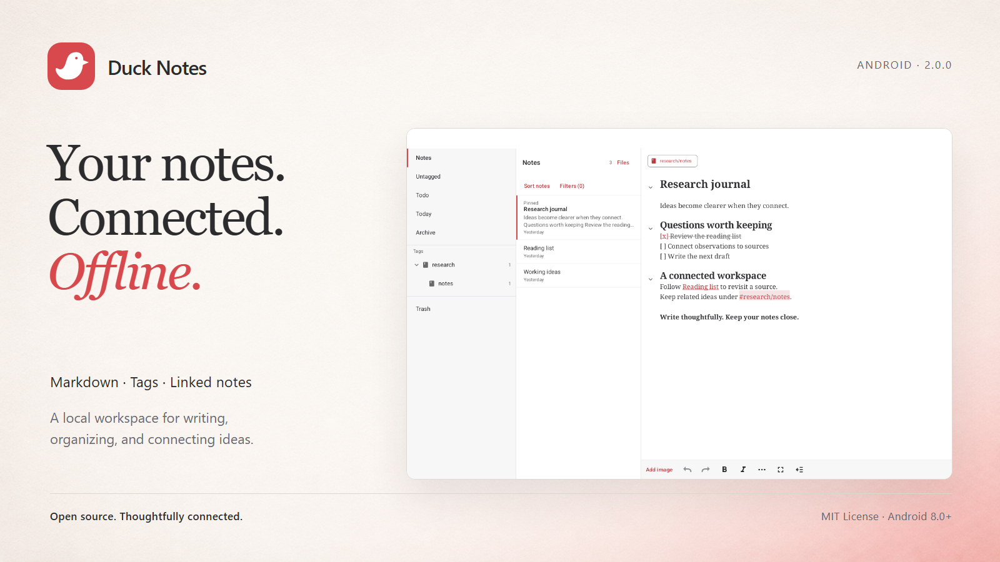

# Duck Notes



Duck Notes is an offline Markdown notes app for Android 8.0 and later. Notes live in a local Room database; images stay in app-owned storage. No account or network connection is required.

This source tree targets `2.0.0`. The release page identifies the currently published APK version. See [SECURITY.md](SECURITY.md) for dependency risks and verification limits.

## Install

Download the signed APK from the [latest GitHub release](https://github.com/ahmed-progra/duck-notes/releases/latest). Open the APK on your Android device; Android may ask you to allow installation from your browser or file manager.

## Build

Install JDK 21 and Android SDK platform 35, then run from the repository root:

```powershell
python -B scripts/security_checks.py wrapper
.\gradlew.bat :app:assembleDebug :app:testDebugUnitTest
```

On macOS/Linux, use `bash ./gradlew` in place of `.\gradlew.bat`. See [SETUP.md](SETUP.md) for SDK configuration, release builds, native tests, and dependency checks.

## Implemented behavior

- Write Markdown with formatting shortcuts, task checkboxes, Undo/Redo, literal Find/Replace, and Focus mode. Failed saves retain recoverable editor text and a note-specific Retry action, including in Settings.
- Organize with nested tags, pinned notes and tags, Archive, and Trash. Sort notes by modification date, creation date, or title; pinned notes stay first. Trash is read-only and has no permanent deletion or automatic purge.
- Search titles and bodies with combinable tag-subtree, pinned, unfinished-task, image, and active/archive filters. Search uses literal prefix terms after a 200 ms pause; by default it includes Archive and excludes Trash.
- Follow `[[wiki links]]` and view backlinks. Notes keep UUID identities and can share titles. Lookup tries the literal title before its derived title; duplicate targets prefer the most recently modified note, then the smallest ID. Renaming never rewrites another note's body.
- Attach validated PNG, JPEG, WebP, or GIF images, with a 20 MiB limit per image. Tap an image to zoom; long-press for its menu, with confirmation before removal.
- Import UTF-8 Markdown/plain text and Duck Markdown ZIP packages. Export or share individual notes or the filtered collection; image-bearing notes use ZIP packages with relative image files. Imports create new identities, including when titles match. See [portability](docs/portability.md) for limits and failure behavior.
- Create portable, passphrase-protected `.duckbackup` files containing notes, images, and tag customization. Restore adds missing note IDs and skips existing IDs without overwriting them. Existing tag customization wins. See the [backup format](docs/backup-format.md).
- Optionally require your Android device screen lock to open notes. Leaving the app locks the session; screenshots and Recents previews are blocked.
- Choose System, English, or Arabic, with right-to-left layouts; light, dark, or system theme; and serif, sans-serif, or monospace editor text at 14–24sp, respecting Android font scaling. Navigation adapts from phones to wider windows.

Cloud sync, accounts, rich table/math editing, OCR, widgets, permanent Trash deletion, and live-database encryption are outside this release.

## Privacy and backup

The live database and attachment files are **not separately encrypted by Duck Notes**. Android's app sandbox and device protection apply. App lock uses your device credential and does not encrypt stored notes. Screenshots and Recents previews are blocked. Unreadable security preferences enable app lock for safety.

Manual `.duckbackup` files use Tink streaming authenticated encryption and a passphrase-derived wrapping key. Forgotten passphrases cannot be recovered. Backups include archived and trashed notes, but exclude credentials and device security settings. Keep the passphrase separately and verify a backup before relying on it.

Android-managed cloud backup requires encryption-capable transport on Android 9 and later; Android 8 backup is disabled. Device transfer is allowed on supported transports. Temporary imports and backup staging stay excluded. Android cloud backup has a **25 MB per-app quota**. Android and OEM transport behavior is outside Duck's control. See [SECURITY.md](SECURITY.md) and [Android's backup guidance](https://developer.android.com/identity/data/autobackup).

## Verification and contributions

The GitHub workflow runs weekly and on source changes. It builds Debug and unsigned Release APKs, runs both JVM suites and lint, inspects release DEX, scans source/history with pinned Gitleaks, and checks resolved Maven coordinates against OSV. It does not run an emulator or publish APKs. Device, restart, migration, backup, layout, and controlled-failure qualification must also pass before a release claim.

Keep real notes, databases, credentials, signing files, machine configuration, and private test evidence out of commits. Before changing behavior, define a reproducible check and its expected result; new guards need a named production mutation that proves they can fail for their stated reason. Preserve existing work and propose exact commit file lists for review.

Duck Notes is available under the [MIT License](LICENSE). Dependencies retain their own licenses, listed in [THIRD_PARTY_NOTICES.md](THIRD_PARTY_NOTICES.md); the app and runtime dependency license texts are also packaged in the APK.
